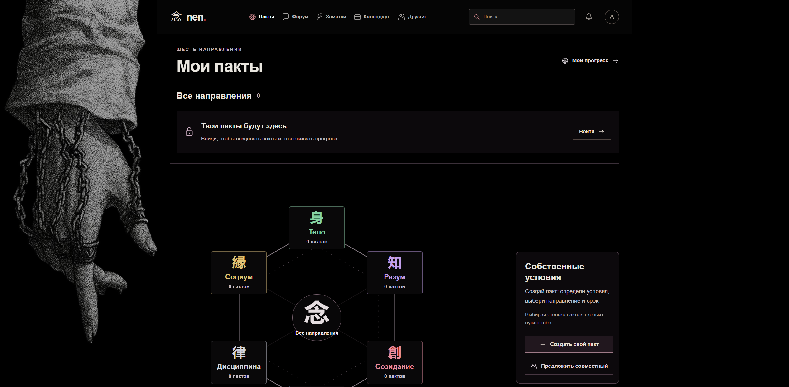

# Nen

Сервис для самоконтроля: личные и совместные пакты, цели, заметки и календарь. Шесть направлений помогают видеть, каким сферам жизни ты уделяешь внимание, а серии показывают, насколько последовательно соблюдаешь свои обязательства.

[](https://github.com/mforseale/nen/actions/workflows/ci.yml)



## Возможности

- **Пакты.** Собственные условия, шесть направлений и четыре уровня длительности: Common — неделя, Rare — месяц, Epic — год, Legendary — без ограничения срока. Количество пактов не ограничено.
- **Прогресс.** Серии растут автоматически; отмечать нужно только срывы. История соблюдения и завершённые пакты сохраняются.
- **Совместные обязательства.** Приглашения другому пользователю, общие условия и срок, отдельный прогресс каждого участника.
- **Профиль.** Годовые цели, достижения, друзья, статус с музыкой, аватарка и закреплённые файлы. У музыки есть повтор и сохранение громкости.
- **Посты и форум.** Форматирование текста, до 10 вложений, лайки и комментарии. Фотографии сохраняют пропорции; черновики восстанавливаются после закрытия редактора и ошибок публикации.
- **Приватность.** Посты, заметки, цели и файлы могут быть публичными, доступными выбранному кругу пользователей или личными. Доступ проверяется на сервере.
- **Календари.** До 10 календарей со своими цветами и оформлением, отдельный и общий просмотр, задачи, события и заметки. Виды месяца, недели и списка.
- **Поиск.** По своим пактам, пользователям и доступным заметкам.

Интерфейс адаптируется к телефонам и широким экранам. Главная и карта пактов построены вокруг символа 念 и направлений «Тело», «Социум», «Дисциплина», «Разум», «Созидание», «Другое».

## Стек

| Часть | Технологии |
| --- | --- |
| Frontend | Next.js 16, React 19, TypeScript, CSS / Tailwind |
| API | Python 3.10+, FastAPI, SQLAlchemy 2 |
| Данные | SQLite, миграции Alembic |
| Развёртывание | GitHub Actions, systemd, Caddy |

```text
api/        API, модели, миграции и серверные тесты
web/        Интерфейс и frontend-тесты
scripts/    Сборка, установка, резервные копии и откат
docs/       Архитектура, инструкции и скриншоты
```

## Локальный запуск

Нужны Git, Python 3.10+ и Node.js 24. Пример для Windows PowerShell:

```powershell
git clone https://github.com/mforseale/nen.git
cd nen
python -m venv api/.venv
./api/.venv/Scripts/python.exe -m pip install -r api/requirements.txt
cd web
npm ci
cd ..
```

В первом терминале запусти API:

```powershell
cd api
./.venv/Scripts/python.exe -m app.db_admin migrate --backup-dir ../.local-backups
./.venv/Scripts/python.exe -m uvicorn app.main:app --host 127.0.0.1 --port 8000 --reload
```

Во втором терминале, из корня проекта, запусти интерфейс:

```powershell
cd web
npm run dev
```

Открой **http://localhost:3000** и зарегистрируйся. Новая установка создаёт пустую базу `api/pact.db`.

Next.js передаёт запросы `/api/v1/*` в FastAPI. Для другого адреса API задай `NEN_API_ORIGIN` в `web/.env.local`; пример находится в `web/.env.example`. Настройки API — в `api/.env.example`.

Существующая база без Alembic требует однократного `migrate --adopt-existing` с резервной копией. Порядок обновления и восстановления описан в [инструкции по миграциям](docs/database-migrations-and-backups.md). Базы, пользовательские файлы, ключи, рабочие `.env`, зависимости и сборки в Git не хранятся.

## Проверки

Из корня проекта:

```powershell
cd api
./.venv/Scripts/python.exe -m unittest discover -s tests -v
cd ../web
npm test
npm run lint
npm run build
```

Серверные тесты используют изолированные базы и временные файлы. Frontend-тесты проверяют прогресс пактов, приватность интерфейса, посты, черновики, профиль и календарь. Production-сборка проверяет TypeScript и рендер маршрутов.

## Развёртывание и документация

Push в `main` запускает CI: тесты API и frontend, lint, production-сборку и проверку готового Linux-пакета. После успешного CI автоматический Deploy устанавливает пакет на VM, проверяет работоспособность и сохраняет одну предыдущую версию для отката. Изменения схемы БД выполняются отдельно.

- [Структура и логика проекта](docs/project-guide.md)
- [Архитектурные решения](docs/architecture.md)
- [Правила разработки](CONTRIBUTING.md)
- [Установка на Linux](docs/linux-deployment.md)
- [Автоматический деплой](docs/automatic-deployment.md)
- [Миграции и резервные копии](docs/database-migrations-and-backups.md)
