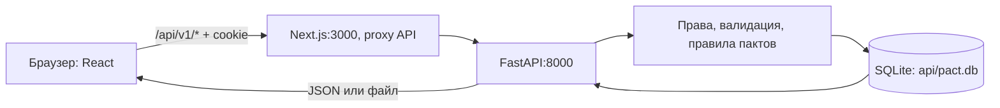
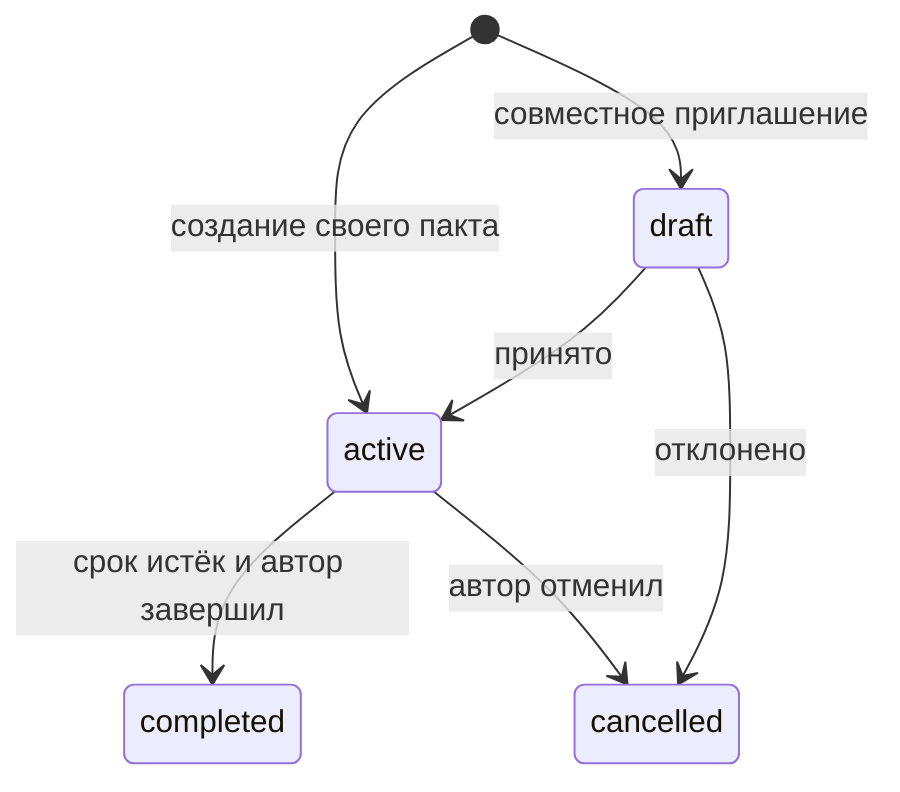

# Nen: актуальная структура и логика

Актуально на 19 октября 2026 года. Этот документ описывает текущий код. Прежние варианты каталога, сердца и двух отдельных экранов профиля в других Markdown-файлах сохранены как история решений.

Схема теперь управляется [миграциями Alembic](database-migrations-and-backups.md): перед первым запуском и обновлением выполняется `python -m app.db_admin migrate --backup-dir <каталог>`. API не создаёт таблицы при импорте и требует текущую версию при старте.

## 1. Общая схема



Сам сайт работает на `http://localhost:3000`, API — на `http://127.0.0.1:8000`. Next.js перенаправляет `/api/v1/*` в API, поэтому браузер работает с одним адресом сайта, включая cookie и приватные файлы.

**Frontend** отображает интерфейс, открывает формы и отправляет запросы. **Backend** определяет, разрешено ли действие, проверяет ограничения и сохраняет результат. Скрытая кнопка сама по себе не даёт защиты: права проверяются сервером независимо от интерфейса. **SQLite** хранит постоянные данные, в том числе загруженные файлы.

## 2. Папки и важные файлы

```text
nen/
  web/                         Next.js 16.4, React 19, TypeScript
    src/app/                   страницы и стили
    src/components/            формы, профиль, карта, календарь, лента
    src/lib/                   API, авторизация, расчёты, типы
    public/                    фон, иконки и исторические изображения
    tests/                     проверки расчётов и рендера React
    next.config.ts             proxy API и лимит multipart
  api/                         FastAPI, SQLAlchemy 2
    app/main.py                сборка приложения и подключение роутеров
    app/models.py              22 таблицы и их связи
    app/routers/               обработчики HTTP
    app/database.py            соединение и сессия БД на запрос
    app/profile_data.py        профиль, видимость и достижения
    app/directions.py          направления и лимит мест
    app/activity.py            фильтры авторов форума
    app/files.py               типы файлов, имена и права на вложения
    tests/                     API, приватность, хранение, параллельные запросы
    alembic/                   зафиксированные ревизии миграций
    pact.db                    рабочая SQLite
  docs/                        решения, объяснения и результаты проверок
  .local-backups/               локальная копия до разрешённой очистки пактов
```

В `web/src/app` путь задаёт страницу: `page.tsx` — главная; `people/[username]/page.tsx` — любой профиль; `forum`, `friends`, `requests`, `notes`, `calendars`, `login` — соответствующие разделы. Динамические `[id]` открывают заметку или отдельный календарь.

Профиль реализован один раз в `components/user-profile.tsx`. `/profile` содержит только переход на свой `/people/<username>`, сохраняя query и hash. `profile-tabs.tsx` управляет вкладками, `profile-feed.tsx` — постами, `profile-files.tsx` — файлами, `pact-seal.tsx` — большой картой пактов, `home-directions.tsx` — схемой главной. Навбар и поиск находятся в `site-header.tsx`.

`lib/api.ts` выполняет JSON-запросы и хранит общий React-хук `useApi`. После успешной записи `refreshData()` посылает событие `nen:refresh`, а открытые компоненты перечитывают свои данные. Загрузка файлов использует multipart из `lib/profile-files.ts`. Таблица направлений и расчёт их отображения — в `lib/directions.ts`, календарные расчёты — в `lib/calendar.ts`.

| Backend-файл | Ответственность |
|---|---|
| `routers/auth.py` | Регистрация, вход, текущая сессия, выход |
| `routers/workspace.py` | Свои и совместные пакты, запросы, отметки, заметки, обсуждения, поиск, профиль |
| `routers/community.py` | Настройки, аватарки, дружба, цели, совместимые JSON-посты |
| `routers/feed.py` | Лента форума, multipart-посты, файлы, закрепы, скачивание и перемотка |
| `routers/calendars.py` | Календари, оформление, задачи/события/заметки |
| `routers/pacts.py`, `routers/users.py` | Совместимые прежние URL с актуальными проверками доступа |

## 3. Авторизация и единый профиль

После регистрации или входа браузер получает `nen_session`: случайный токен в HttpOnly cookie, срок — 30 дней. JavaScript не читает этот токен; браузер добавляет cookie к запросам. В БД хранится хеш токена, а пароль хранится как PBKDF2-хеш с солью. Выход удаляет серверную сессию; просроченная и поддельная сессии не дают доступ к личным методам.

`AuthProvider` определяет текущего пользователя через `/auth/me`. При открытии `/people/<username>` сервер собирает профиль для конкретного зрителя. Владелец видит личные данные, настройки, карту и отметки. Посетитель видит только разрешённые цели, посты, заметки и файлы, а также действия дружбы и предложения пакта. `/my/pacts` запрашивается только в собственном профиле. Прямой `#pacts` в чужом профиле открывает обзор.

## 4. Пакты

Готовые пакты больше не предлагаются. `/catalog` возвращает пустой список, старый метод заключения шаблона — 410. `app/catalog.py` остаётся справочником совместимости старых записей; автоматического создания готовых пактов нет. Рабочие старые пакты были однократно удалены по явному указанию пользователя.

Пользователь задаёт название, условия, направление и тир:

| Тир | Личный пакт |
|---|---|
| Common | 7 дней |
| Rare | календарный месяц |
| Epic | календарный год |
| Legendary | без конечной даты |

Направления: Тело, Социум, Дисциплина, Разум, Созидание, Другое. В каждом направлении допускается до трёх активных пактов каждого тира: всего до **72 активных мест**. Совместные пакты занимают места у каждого участника. Ожидающее приглашение место не резервирует. При принятии свободное место повторно проверяется у обоих.

Основная запись — `Pact`. Дополнительно связаны `PactDetails` (срок/старый шаблон), `PactTopic` (направление), `PactParticipant` (участники) и `PactCheckin` (ежедневные отметки). Совместному пакту соответствует `PactRequest`.



У совместного пакта длительность произвольная, задаётся в днях; тир выводится из неё: до 7 дней — common, до 31 — rare, больше — epic. Срок начинается после принятия приглашения. Legendary у личного пакта означает отсутствие дедлайна.

Отметить можно только сегодняшний день, с учётом переданного часового пояса. Повторная отметка не увеличивает результат. Каждый участник совместного пакта отмечает собственное выполнение. Конечный прогресс — отмеченные дни / длительность, до 100%; пожизненный показывает количество дней. «Отметить все» обрабатывает доступные активные пакты одной транзакцией, пропуская уже отмеченные, истёкшие и достигшие лимита дней.

Истечение срока само по себе не запускает фоновую задачу: пакт остаётся active до завершения/отмены и продолжает занимать место. Перенос меняет направление, сохраняя условия и отметки; при переносе совместного пакта место нужно обоим участникам.

## 5. Форум, посты, друзья и приватность

Профиль и форум читают **одни и те же посты** `ProfilePost`. Копия публикации для форума не создаётся. Изменение или удаление исходного поста отражается в обеих лентах.

Для постов, целей и самостоятельных файлов действуют `public / friends / private`: всем, принятым друзьям, только автору. Для заметок — `public / invited / private`: во втором варианте автор явно указывает людей, и доступ хранится в `NoteGrant`. Ожидающая заявка в друзья доступа к friends-контенту не даёт. После удаления дружбы следующая выдача и отдельный запрос файла снова применяют права.

Фильтры форума `all / friends / mine` отбирают авторов **поверх** проверки видимости. «Друзья» не включает собственные посты и не раскрывает чужие приватные данные. В «Моя» автор видит и свои приватные посты. Комментарии к пользовательскому пакту доступны только его участникам. Trending — число доступных сообщений за последние 7 дней; контент без права просмотра в него не попадает.

Лента форума и списки комментариев сейчас ограничены последними 100 доступными записями; кнопка «показать ещё» постепенно раскрывает полученный набор. Серверной пагинации более старого контента пока нет. Автоматического realtime-обновления через WebSocket тоже нет: данные обновляются после своих действий, переходов или повторного запроса.

## 6. Файлы и оформление постов

До 10 вложений в посте, до 25 МиБ на файл, до 50 МиБ вложений на пост. В закрепе профиля — до 10 файлов суммарно, включая вложения постов и отдельно загруженные файлы. Закреп — флаг на исходном файле, не новая копия; снятие закрепа сохраняет файл в библиотеке.

Данные файлов хранятся в SQLite, в `ProfileFile.content`. `post_id` связывает вложение с постом; оно наследует его приватность. Аватарки хранятся отдельно в `ProfileAvatar`, старые картинки постов — в совместимых полях `ProfilePost`. Бинарные поля читаются из БД по необходимости, а не включаются в JSON-списки.

Картинки, аудио и видео показываются встроенно, другие форматы скачиваются. Файл выдаётся через отдельный API с повторной проверкой прав; поддерживаются HEAD и HTTP Range. HTML/SVG не исполняются в интерфейсе, для произвольных форматов используется скачивание. Имена очищаются от путей и управляющих символов.

В ленте пост имеет фиксированную высоту. Галерея уменьшает картинки внутри доступного места, первое аудио находится под ними. Подробный просмотр раскрывает полный текст и остальные файлы; исходные файлы при этом не уменьшаются.

## 7. Календари, цели и достижения

У пользователя до 10 календарей, цвета уникальны внутри его набора. Каждый календарь хранит тему: classic, grid или journal. Общий вид объединяет выбранные календари; отдельный URL открывает один. Запись содержит дату, тип task/event/note, текст, приоритет, при необходимости время. Только задачу можно отметить выполненной. Любой перенос или редактирование проверяет владельца исходного и целевого календаря.

Годовая цель — числовая пара `current / target`, описание, год, единица измерения и видимость. Достижения вычисляются из реальных пактов и отметок при запросе профиля; отдельной таблицы вручения наград нет. Тировые и тематические достижения учитывают активные/завершённые пакты хотя бы с одной отметкой; «Сдержанное слово» требует завершения с выполнением минимум 80% дней.

## 8. Хранение и развитие схемы

SQLite по умолчанию находится в `api/pact.db`, путь можно изменить через `DATABASE_URL`. Запускать API нужно из `api`, поскольку путь по умолчанию относительный. На запрос создаётся SQLAlchemy Session, действия сохраняются транзакциями. Проверка вместимости пактов берёт блокировку пользователя перед проверкой и записью.

Сейчас `Base.metadata.create_all()` при старте создаёт недостающие таблицы. В `alembic/versions` пока нет миграций: изменение колонок существующей таблицы автоматически не выполняется. Это текущий способ развития схемы, а не готовая система версионных миграций.

В репозитории остаются неиспользуемые файлы прежнего макета (`mock-data.ts`, `pact-card.tsx`, прежние иллюстрации сердца) и совместимые API. Они не подставляют демонстрационные пакты в активные страницы.

## 9. Запуск и проверка

Из `api`: `.venv\Scripts\python.exe -m uvicorn app.main:app --host 127.0.0.1 --port 8000 --reload`.

Из `web`: `npm run dev`. API-документация: `http://127.0.0.1:8000/docs`.

Проверки: в `api` — `.venv\Scripts\python.exe -m unittest discover -s tests -v` и `.venv\Scripts\python.exe -m pip check`; в `web` — `npm test`, `npm run lint`, `npm run build`. API-тесты используют отдельную SQLite, включая временные файловые базы для переоткрытия и параллельных запросов. Пользовательская база не используется для тестовых аккаунтов и файлов.

Актуальный протокол: [full-verification-2026-10-19.md](full-verification-2026-10-19.md).
